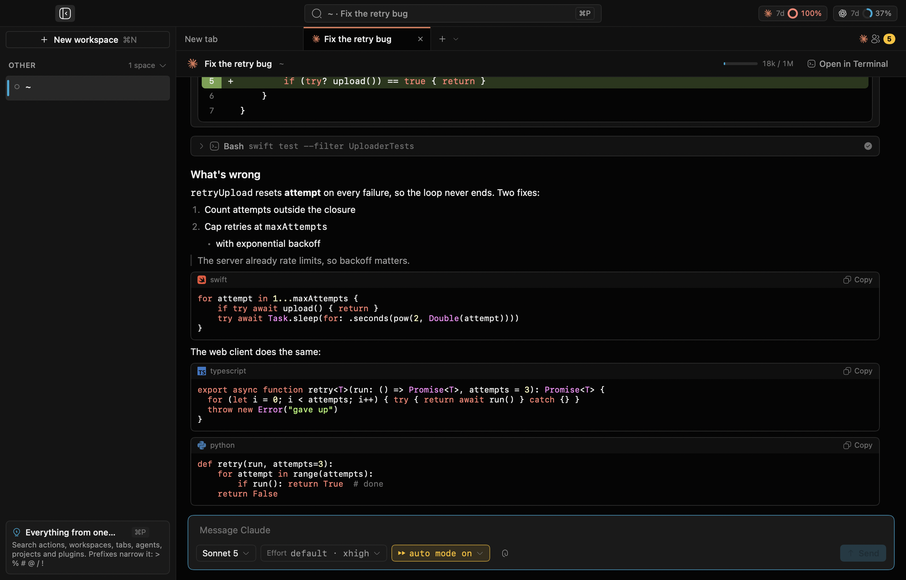
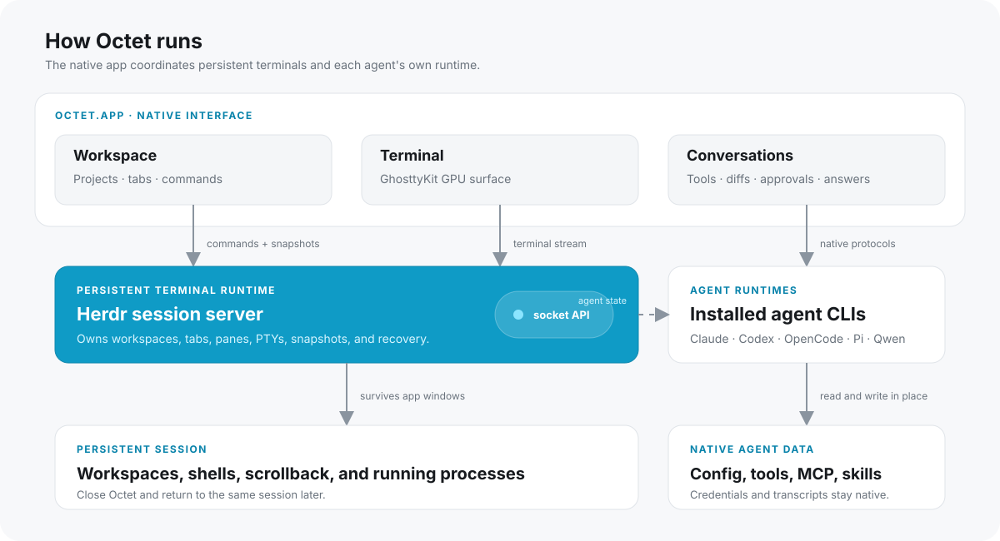

<div align="center">

<h1 align="center">
  <picture>
    <source media="(prefers-color-scheme: dark)" srcset="docs/assets/octet-logo-dark.png">
    <source media="(prefers-color-scheme: light)" srcset="docs/assets/octet-logo-light.png">
    
  </picture>
  &nbsp;Octet
</h1>

### The native macOS terminal built for coding agents

Run agents side by side, see what each one is doing, and move between projects without losing the terminal underneath.

<p>
  <a href="https://github.com/JackTPatterson/octet/releases"><strong>Releases</strong></a>
  ·
  <a href="#build-from-source"><strong>Build from source</strong></a>
  ·
  <a href="docs/PLAN.md"><strong>Architecture</strong></a>
  ·
  <a href="https://github.com/JackTPatterson/octet/issues"><strong>Issues</strong></a>
</p>

<p>
  
  
  
  <a href="LICENSE"></a>
</p>

</div>

---



<p align="center"><em>A real agent process, rendered as a native conversation.</em></p>

Octet is a native terminal and workspace for people who run more than one coding agent. It combines a GPU-rendered terminal with native project navigation, agent-aware tabs, session recovery, a universal marketplace, and an optional conversation view over the real agent process.

It does not proxy prompts through a second service or replace your agent. Claude Code, Codex, OpenCode, and other installed CLIs keep their own configuration, credentials, models, tools, and transcripts. Octet gives them a shared place to work.

**Built on two open-source projects.** Terminal sessions, panes, and agent-state detection come from [Herdr](https://github.com/herdrdev/herdr) (Apache-2.0), which Octet bundles as its session server with one small rendering patch. Terminal rendering comes from [Ghostty](https://github.com/ghostty-org/ghostty) (MIT) through GhosttyKit. Octet is the native macOS layer on top: the sidebar, tabs, Visual Twin, native agent conversations, recovery, palette, and marketplace.

> [!NOTE]
> Octet is pre-1.0. Signed and notarized builds are on the [Releases](https://github.com/JackTPatterson/octet/releases) page as prereleases; expect the feature set to keep moving.

## Why Octet

Agent-heavy work breaks the assumptions of a traditional terminal. A tab title does not tell you who is waiting, completed sessions disappear into scrollback, subagents are easy to miss, and every vendor ships a separate way to manage prompts, skills, and tools.

Octet makes those states part of the interface:

- **Projects stay coherent.** Repositories, worktrees, branches, workspaces, tabs, and panes stay visually grouped.
- **Agent state at a glance.** See which agents are working, blocked, idle, or done without opening every tab.
- **Native conversations, real processes.** The Visual Twin renders an agent transcript as a macOS conversation while input still goes to the actual CLI.
- **Sessions that survive the window.** The bundled session server owns terminals and agents, so workspaces persist across app relaunches.
- **One library for every agent.** Browse and manage MCP servers, plugins, skills, and prompts from a single marketplace.
- **A terminal first.** Splits, scrollback search, themes, shell history, completions, image paste, and keyboard-driven navigation remain first-class.

## Highlights

### Your agents, organized like work

The sidebar groups workspaces by repository and branch. Each running agent gets its own vendor mark, status, context usage, and activity. Tabs automatically follow stable terminal titles, while names you set manually stay untouched.

Agent notices tell you when background work finishes or needs input. Click a notice to jump directly to the relevant pane; work already on screen stays quiet.

### The Visual Twin

Press `⌘⇧V` to switch an agent pane between its terminal and a native transcript view.

The twin reads the structured session files the agent already writes. It renders messages, reasoning, tool calls, command output, diffs, checklists, model information, and context usage without scraping terminal repaints. Answers typed into the twin are sent to the same live process.

When an agent is waiting on a numbered choice or a yes/no decision, Octet can turn that terminal prompt into native actions. If no supported transcript is available, the terminal remains fully usable.

### Command palette

`⌘P` opens one fuzzy-searchable surface for the whole application.

| Prefix | Finds |
| :---: | --- |
| `>` | Actions, including tabs, panes, workspaces, worktrees, and settings |
| `%` | Workspaces with project, branch, and agent state |
| `#` | Tabs across every workspace, including subagent tabs |
| `@` | Running agents and their panes |
| `/` | Projects in common development directories |
| `!` | Session plugins, actions, panes, logs, and installation controls |

Use `↑` / `↓` or `⌃N` / `⌃P` to move, `↩` to run, `⇥` to change filters, and `esc` to close.

### Agent marketplace

Open the Marketplace with `⌘⇧M` to manage integrations across installed agents.

| Library | How Octet handles it |
| --- | --- |
| **MCP servers** | Reads and writes each supported agent's own MCP configuration |
| **Plugins** | Discovers configured marketplaces and calls the agent's native plugin CLI |
| **Skills** | Stores one shared copy and links it into selected agents |
| **Prompts** | Shares reusable prompt files across agent-specific command folders |

Per-agent chips show exactly where an item is installed. When a new MCP server or plugin requires an agent restart, **Reload Agents** resumes eligible conversations in place instead of discarding them.

### A smarter shell prompt

At a bare shell prompt, Octet can provide syntax highlighting, history suggestions, selection, undo/redo, and completions without taking over programs running inside the pane.

Completion sources include:

- executables, shell built-ins, files, and directories;
- command specs, subcommands, options, and descriptions;
- Git branches, package scripts, Make targets, just recipes, and Compose services;
- local shell history ranked by frequency and recency; and
- common command sequences learned from that history.

Anything Octet does not handle is passed through to the shell. Agent TUIs, editors, pagers, and full-screen programs continue to receive their keys normally.

### Recovery that understands agents

Octet journals the agent, session ID, working directory, workspace, and tab for every agent pane it can identify. After a crash, forced shutdown, or session-server restart, it offers to resume interrupted work in the right project.

Recovery uses the agent's native mechanism—such as `claude --resume <id>` or `codex resume <id>`—and can recreate a missing workspace. Sessions can also be recovered later from the command palette.

## Agent support

Octet is designed around capabilities, not a single vendor. It discovers agent homes by convention, reads each tool's native command and prompt folders, and only exposes operations a host supports.

Claude Code, Codex, and OpenCode have deeper transcript/catalog integrations. Other installed agents—including tools following the common `~/.<agent>` layout—can still participate in the shared library, workspace UI, status system, and terminal workflows where their CLI capabilities allow it.

### Subagent tabs

The **Install Subagent Tabs Hook** palette action installs an agent-specific hook that opens spawned work in a named background tab. The hook is inactive outside Octet panes and keeps a `.octet-backup` beside any configuration it changes.

The same operation is available from the bundled CLI:

```sh
/Applications/Octet.app/Contents/MacOS/octet-cli install-subagent-hook claude
```

Reinstall the hook after moving the app because its configuration stores the CLI path.

## Build from source

### Requirements

- macOS 14 or newer on Apple Silicon
- Xcode 26 or 27 with command-line tools
- [XcodeGen](https://github.com/yonaskolb/XcodeGen): `brew install xcodegen`
- [Herdr](https://github.com/herdrdev/herdr): `brew install herdr` (or Rust and Zig 0.16, to build the patched engine yourself)

Two build inputs are downloaded or built by script rather than committed: `Vendor/GhosttyKit.xcframework` (about 120 MB) and the session-server binary at `Vendor/engine/octet-engine`.

### Build and launch

```sh
git clone https://github.com/JackTPatterson/octet.git
cd octet

# Downloads the prebuilt GhosttyKit.xcframework and verifies its pinned SHA-256.
scripts/fetch-ghosttykit.sh

# Copies the Homebrew Herdr binary into Vendor/engine/octet-engine.
scripts/fetch-engine.sh

xcodegen generate
xcodebuild \
  -project Octet.xcodeproj \
  -scheme Octet \
  -configuration Debug \
  -derivedDataPath build/DerivedData \
  CODE_SIGN_IDENTITY=- DEVELOPMENT_TEAM= \
  build

open build/DerivedData/Build/Products/Debug/Octet.app
```

`CODE_SIGN_IDENTITY=- DEVELOPMENT_TEAM=` signs the build ad hoc, so you don't need the maintainer's Apple team. With your own Apple Development certificate, pass `DEVELOPMENT_TEAM=<your team ID>` instead. Keychain "Always Allow" grants then survive rebuilds, which ad-hoc builds don't.

Octet runs its own build of the Herdr engine: one without Herdr's terminal client, that streams each pane to Octet (which draws it natively), lays a tab out at the size Octet shows it, and adds split dividers to `pane.layout`, `pane.equalize`, `pane.resize_cells`, and left/up and whole-tab placement for `pane.split` and `pane.move`. Stock Herdr doesn't work. `scripts/build-engine.sh` builds it from a checkout of that engine at `../octet-engine` (or `OCTET_ENGINE_SOURCE`); it needs Rust/cargo:

```sh
scripts/build-engine.sh
```

Octet starts an isolated named session, `octet`, with managed configuration at:

```text
~/Library/Application Support/Octet/terminal.toml
```

That session does not modify a standalone Herdr session running elsewhere.

### Run the tests

```sh
xcodebuild \
  -project Octet.xcodeproj \
  -scheme OctetCore \
  -derivedDataPath build/DerivedData \
  CODE_SIGN_IDENTITY=- DEVELOPMENT_TEAM= \
  test
```

The core tests need neither GhosttyKit nor the engine.

## Keyboard map

Octet is designed to stay fast without leaving the keyboard.

| Shortcut | Action | Shortcut | Action |
| --- | --- | --- | --- |
| `⌘P` | Command palette | `⌘⇧P` | Palette with all commands |
| `⌘O` | Open folder | `⌥⌘N` | New window |
| `⌘N` | New workspace | `⌃⌘↑` / `⌃⌘↓` | Previous / next workspace |
| `⌘T` / `⌘W` | New / close tab | `⌘1`…`⌘9` | Select tab (`9` = last) |
| `⌘⇧[` / `⌘⇧]` | Previous / next tab | `⌘B` | Toggle sidebar |
| `⌘D` / `⌘⇧D` | Split right / down | `⌘⇧↩` | Toggle pane zoom |
| `⌘⌥←↑→↓` | Focus pane | `⌘⇧V` | Visual Twin / terminal |
| `⌘⇧A` | Agents board | `⌘⇧M` | Marketplace |
| `⌘F` | Find in scrollback | `⌘G` / `⇧⌘G` | Next / previous result |

The complete, authoritative shortcut list is also available in **Settings → Keyboard**.

## Terminal details

<details>
<summary><strong>Persistent workspaces and native chrome</strong></summary>

The bundled session server owns every pseudo-terminal. Octet subscribes to its socket API for workspace, tab, pane, and agent changes, then renders project navigation and tab management with native SwiftUI/AppKit controls.

Workspaces remain in the named session when the app window closes. Git worktrees are grouped under their main repository, while branches receive their own visual identity in the sidebar.

</details>

<details>
<summary><strong>Themes and terminal colors</strong></summary>

Octet ships dark and light appearances and can follow the colors you already use. **Settings → Appearance → Follow your terminal's colours** reads Ghostty configuration or another `key = value` theme file. Missing values fall back safely, and light terminal backgrounds switch the surrounding chrome as well.

</details>

<details>
<summary><strong>Images and clipboard behavior</strong></summary>

Pasting an image writes it to `~/Library/Application Support/Octet/pasted` and inserts the path, which is what terminal agents can consume safely. Files copied in Finder use their existing paths. Octet retains the latest fifty generated paste files.

Clipboard actions can display a confirmation toast with a preview, including copy-on-select and session copy mode.

</details>

<details>
<summary><strong>Bottom-anchored output</strong></summary>

Terminal content can start at the top of a pane or remain anchored near the bottom while output is short. Bottom anchoring moves the rendered surface instead of changing the grid, avoiding shell reflow and leaving split panes predictable.

</details>

## Architecture



- **Interface:** SwiftUI with AppKit integration for window and terminal behavior.
- **Rendering:** a vendored GhosttyKit framework provides GPU terminal rendering.
- **Persistence:** a bundled Herdr binary owns the named session and exposes its socket API. It also detects agent state.
- **Agent data:** native CLI configuration and structured transcript files remain the source of truth.
- **Local storage:** generated settings, recovery journals, and pasted images live under `~/Library/Application Support/Octet`.

For the original implementation plan and protocol-level notes, see [docs/PLAN.md](docs/PLAN.md). The native-agent UI design is documented in [docs/NATIVE-AGENT-UI.md](docs/NATIVE-AGENT-UI.md).

## Continuous integration and releases

Every pull request and every push to `master` builds Octet and runs its tests ([`.github/workflows/ci.yml`](.github/workflows/ci.yml)).

Production releases ship from the `release` branch ([`.github/workflows/release.yml`](.github/workflows/release.yml)). To release, bump `CURRENT_PROJECT_VERSION` (and `MARKETING_VERSION` for a new version) in `project.yml` on `master`, then bring `master` into `release`, either with a pull request or with `git push origin master:release`. The workflow tests the build, then runs `scripts/release.sh` in the `production` environment, which signs, notarizes and packages the build. It publishes the DMG and ZIP as a GitHub release and commits the refreshed `appcast.xml` to `master`, so installed copies update. A version that is already published stops the run before anything is signed.

The `production` environment (Settings › Environments) holds the secrets listed at the top of `release.yml`: the Developer ID certificate as a base64 `.p12` and its password, the Apple ID, team and app-specific password for notarization, and Sparkle's EdDSA private key (`generate_keys -x`). Add required reviewers there to approve each release before it's signed.

## Release builds

The same pipeline runs locally from a Mac with the certificate and credentials in its keychain. The release script performs the full distribution pipeline: Release build, Developer ID signing, hardened-runtime validation, notarization, stapling, Gatekeeper assessment, DMG packaging, Sparkle archive signing, and appcast generation.

```sh
scripts/release.sh
```

One-time certificate and `notarytool` credential setup is documented at the top of [`scripts/release.sh`](scripts/release.sh). Sparkle's `generate_keys` must also have created the EdDSA key in the release Mac's Keychain. Versioned DMG and ZIP artifacts are written to `build/release/`; publish both under the tag printed by the script, then commit and push the refreshed `appcast.xml`.

To package an already-built app without running the full release flow:

```sh
scripts/make-dmg.sh /path/to/Octet.app build/Octet.dmg
```

## Debugging

Set `OCTET_SNAPSHOT_DIR` to capture the current app window and terminal text once per second without Screen Recording permission:

```sh
OCTET_SNAPSHOT_DIR=/tmp/octet-snap \
  open -n --env OCTET_SNAPSHOT_DIR=/tmp/octet-snap /path/to/Octet.app
```

This writes `window.png` and `terminal.txt` into the selected directory.

The sidebar’s **Onboarding checklist** row sits below Search. It opens shortcuts for project setup, agents, appearance, issue connections and notifications. Check off steps yourself; progress is saved across restarts.

## Workspace setup and project configuration

New worktrees have a tracked setup state: Preparing, Awaiting approval, Running, Ready or Failed. The project-actions toolbar shows the state and offers **Open log** and **Retry setup**. Issue workspaces and Best-of-N agents wait for successful setup by default. A failed setup keeps the pending agent launch waiting; retrying successfully releases it once. Worktrees created by an agent also receive configuration, but an agent already running outside Octet's launch flow cannot be paused retroactively.

Check in `octet.json` at the repository root:

```json
{
  "version": 1,
  "setup": "npm ci",
  "archive": "npm run stop",
  "archiveTimeoutSeconds": 120,
  "waitForSetup": true,
  "copyPaths": [".vscode/settings.json"],
  "sharedDirectories": [".cache"],
  "actions": [
    {"id": "dev", "name": "Dev server", "command": "npm run dev", "icon": "play"},
    {"id": "test", "name": "Tests", "command": "npm test", "icon": "flask"}
  ],
  "defaultTabs": [
    {"title": "Dev server", "command": "npm run dev"}
  ]
}
```

All copy/shared paths must already exist in the primary checkout and be wholly gitignored. Copies preserve existing worktree files; shared directories are symlinks, so changes are shared with the primary checkout. Omit `sharedDirectories` when dependencies must be independent in each worktree. Paths are literal, repository-relative paths: traversal, `.git`, globs and symlinks escaping the checkout are rejected. The existing automatic copy of ignored project `.env` files remains enabled.

Use `.octet/local.json` in the **primary checkout** for machine-specific overrides, and add it to `.gitignore`. Only fields present in this file override the checked-out branch's `octet.json`; lists replace shared lists, while actions merge by `id`. Actions edited through Octet remain local preferences and override an action with the same id. Removing a local action restores its repository definition. Configuration reloads when the project actions menu opens.

An explicit `setup` overrides `.octet/setup` and `conductor.json`; an empty string disables the setup command. Setup uses a noninteractive login shell in the new checkout, with `OCTET_ROOT_PATH`, `OCTET_WORKTREE_PATH` and its assigned `OCTET_PORT`. Output is logged under Octet's Application Support directory. Project setup/default-tab commands use the existing repository trust prompt. Set `waitForSetup` to `false` only when an agent may start while setup is running; file preparation still completes first, and setup failures still appear. Default tabs open after successful setup, once per worktree. Turning off worktree setup in Settings skips this preparation.

After an app restart, an in-progress setup is marked interrupted rather than ready. Inspect its log before retrying; a pending agent launch is not automatically recreated after restart.

### Cleanup and archive

**Clean Up Worktrees…** in the command palette protects open terminals/agents (including unknown process liveness), retained native conversations, unsaved editor buffers, saved browser feedback and running setup. Close those workspaces, save files, and send or clear feedback before removal. Octet rechecks application state and Git state around the archive command; only merged, clean worktrees qualify. Branches are retained.

An optional `archive` command in `octet.json` runs inside the worktree before removal, with `OCTET_ROOT_PATH` and `OCTET_WORKTREE_PATH`. The confirmation shows the command. `archiveTimeoutSeconds` defaults to 120 (1–3600). Failure or timeout retains the worktree and offers Retry; the error includes the log path under Application Support `archive-logs`. Retry runs the hook again, so write teardown commands to tolerate partially completed work. A timeout terminates the hook's process group. Raw `git worktree remove` outside Octet does not run Octet hooks.

### Scheduled project jobs

Use the **calendar button beside project actions** to create, edit, pause, run or delete project jobs and inspect recent run history. Choose Claude Code or Codex, a prompt, a five-field cron expression and an IANA timezone such as `America/New_York`. Hourly, daily, weekday and weekly presets are provided. Cron supports numeric lists, ranges and steps; Sunday is 0 or 7. When both day-of-month and weekday are restricted, either may match. DST follows the selected timezone: missing wall-clock minutes are skipped and repeated minutes can occur twice.

Jobs share Check-ins' existing timer and global pause. They execute while Octet is open; missed occurrences collapse into one on return. Each run can create a fresh worktree or open a new agent tab in the project's already-open workspace. Fresh worktrees use project setup and its startup policy. An optional precheck runs in the primary checkout with a timeout; only exit 0 continues, and failures record a skipped run with a log. Saving the schedule authorizes its precheck and prompt. No schedules are enabled merely by opening a repository.

An occurrence is saved before dispatch, and the same job cannot overlap an active run. Run history tracks preparation, setup, agent launch and observed completion. A launch interrupted by restarting Octet pauses its schedule for inspection. Unobservable agents are not reported as successful. **End tracking** pauses the schedule without stopping the agent; inspect its workspace before enabling another run. Separate jobs may run concurrently. Job records and history live in Application Support `project-jobs.json`; this is app-managed scheduling, not a launch daemon.

## Browser annotations

Open an HTTP or HTTPS page in the Browser pane and click the **element picker** beside the More menu. Click an element to capture its selector, sanitized HTML, computed styles and a cropped screenshot. Escape exits the picker. Form controls and editable regions cannot be selected directly; scripts and form values are omitted from captured HTML. Screenshots show the visible selection, so review them before sending.

The annotation tray lets you add a note per element, remove captures, copy the context, or choose an agent in the current workspace and **Send to agent**. Native conversations receive image attachments. Terminal agents receive the context and explicit image paths under Octet's Application Support directory. Annotations remain available if terminal delivery fails. Up to eight annotations may be collected at once, including across pages. In the normal browser profile, annotation notes and element context are saved per workspace and restored after closing the pane or restarting Octet. Screenshots are transient and are not restored; terminal-agent screenshot files remain available for that agent to read. Private-page annotations stay in memory. Sending or clearing annotations updates the saved drafts.

The Browser **More → Viewport size** menu offers Fit pane, Phone (390 × 844), Tablet (768 × 1024) and Laptop (1440 × 900). These change the actual CSS viewport, with scrolling when larger than the pane; they do not spoof a mobile user agent or touch hardware.

The picker currently targets the top-level document; iframe contents and shadow-root internals are not traversed. Source-file mapping is not inferred from framework internals.

## Browser Control

Turn on **Browser Control** in Settings › Plugins to let agents drive the Browser pane. Octet adds an `octet-browser` MCP server (`octet-cli browser-mcp`) to Claude Code, Codex, Gemini, Qwen, OpenCode, Cursor and Copilot, and removes it when the plugin is turned off. Its 29 tools have chrome-devtools MCP's names and arguments: `new_page`, `navigate_page`, `take_snapshot`, `click`, `fill_form`, `type_text`, `press_key`, `upload_file`, `handle_dialog`, `take_screenshot`, `evaluate_script`, `list_console_messages`, `list_network_requests`, `emulate`, `performance_start_trace`, `lighthouse_audit` and the rest, so instructions written for that server carry over.

They act on the pane's own WebKit page rather than a separate Chrome: each workspace's agent drives that workspace's page, the pane opens beside the terminal so you see what it does, localhost servers load, and sign-ins in the pane are used. A snapshot lists the page's accessibility tree with a uid per element, which the input tools take. Alerts, confirms and prompts wait for `handle_dialog` while an agent is driving.

Differences from Chrome: input is dispatched as DOM events (no CSS `:hover`; sites that reject untrusted events may ignore it); there is one page per workspace, without tabs or isolated contexts; headers and bodies are captured for the document, `fetch` and XHR, with other resources from Resource Timing; performance recordings use the page's Performance APIs rather than a DevTools trace; `lighthouse_audit` runs a subset of Lighthouse's accessibility, SEO and best-practice checks in the page; network and CPU throttling are not available. Nothing is injected into pages while the plugin is off.

## Issues and agent access

The Issues pane connects to multiple Linear workspaces and Jira sites using macOS Keychain. Jira supports Cloud, scoped tokens through Atlassian's gateway, and HTTPS Server/Data Center sites using a PAT or username/password. Choose Assigned to me or Reported by me, post comments, change status, or assign an issue to yourself. Start workspace creates an issue-named worktree and starts an installed Claude Code or Codex agent with the issue description; an existing matching worktree is reopened. The issue ID, URL, tracker and connection ID are saved in that checkout’s Git metadata (no credentials or tracked files). The project toolbar link opens the saved ticket. A branch already linked to a different issue/connection is not silently reassigned.

List and board views share the same project/team, scope, and person filters. Jira favourite filters intersect the selected project and filters. Expand an issue to see its description, priority, sub-issues and comments. The board groups fetched issues by status; change status through a card's actions.

Agents can read issues through the bundled `octet-cli` (JSON on stdout; failures on stderr with a nonzero exit):

```sh
octet-cli issues connections --tracker linear
octet-cli issues containers --tracker linear --connection CONNECTION_ID
octet-cli issues list --tracker linear --connection CONNECTION_ID --container TEAM_ID --who assigned
octet-cli issues read --tracker jira --connection CONNECTION_ID --key PROJ-123
octet-cli issues list --tracker github --in /path/to/repo --scope all
```

Omit `--connection` to use the first saved connection. Lists currently fetch at most 100 issues; comments fetch a bounded page. There is no issue-specific MCP server yet. The CLI shares the app's API clients and Keychain storage and never prints connection secrets.

Agent reads also support:

```sh
octet-cli issues read --current --include-comments
octet-cli issues list --tracker linear --connection CONNECTION --container TEAM --limit 100
# Continue with the returned nextCursor, preserving the same selectors:
octet-cli issues list --tracker linear --connection CONNECTION --container TEAM --cursor CURSOR
```

`list` now returns an object with `issues`, `truncated` and optional `nextCursor`, rather than a bare array. Without a limit it follows pages, stopping between requests after a 20-second budget or 10,000 issues and returning a continuation. `--limit` accepts 1–1000. Cursors are bound to tracker, connection, project/team, filters and directory. Linear uses cursors, Jira Cloud uses page tokens, and Jira Server uses offsets; GitHub uses bounded `gh` reads with offsets. Lists can change while paging, so consumers should deduplicate by issue ID. The UI reports incomplete reads rather than silently presenting a partial list as complete. Comment reads follow pages (up to 10,000, then an explicit error). `--current` resolves from any subdirectory of a linked checkout and uses its saved connection.

Agents can also use `octet-cli issues-mcp` as a stdio MCP server. The four read-only tools are `issues_connections`, `issues_containers`, `issues_list` and `issues_read`. Enable **Let agents read issues** in Settings to install the server into supported agents, or configure an MCP client with command `/Applications/Octet.app/Contents/MacOS/octet-cli` and arguments `["issues-mcp"]`. List calls default to 100 issues and preserve continuation cursors. Pass `in` for repository context; `issues_read` accepts `current: true` and `include-comments: true`.

Drag cards between status columns in the issue board. Starting a drag reveals available destination statuses, including empty columns. Drops recheck the issue's allowed transitions; failed writes roll back. When Jira has multiple actions leading to a status, choose the named action in issue details. Workflows requiring additional Jira fields still need the tracker website.

### Orca comparison, 2026-10-19

Source review of the local `stablyai/orca` clone at `b358328b`, not a live product test. The six requested integration areas are present in Octet. Remaining depth differences:

| Area | Orca evidence in the clone | Octet follow-up |
| --- | --- | --- |
| Agent reads | `src/main/linear/mcp-issue-list.ts` walks pages, applies a time budget, and returns continuation metadata | Pagination and read-only MCP implemented (`octet-cli issues-mcp`) |
| Worktree context | `src/main/linear/issue-context.ts` resolves `--current` from linked worktrees and includes optional context | Issue/connection metadata and `--current` implemented |
| Relations | `src/main/linear/issue-relation-mutation.ts` creates and deletes relations | Add relations and activity to detail, followed by issue creation and broader assignment |
| Board workflows | Renderer `task-page-jira-board-move.ts` and `task-page-jira-board-transitions.ts` implement board movement | Drag-and-drop implemented with fresh allowed-transition checks and rollback on write failure; ambiguous transitions use the detail menu |
| Custom views | `src/main/linear/linear-custom-view-graphql.ts` defines custom-view queries | Add Linear custom views and richer label/priority/state filtering |

Broader Orca README features worth evaluating separately are its mobile companion, SSH worktrees, and browser Design Mode. Those are advertised capabilities, not verified parity gaps from this integration-focused review. Octet already has parallel worktrees, terminal splits, agent orchestration and review surfaces, so feature names alone do not establish a gap.

## Project status

The core application, terminal rendering, native sidebar and tabs, agent state, subagent hooks, recovery, marketplace, slash menu, Visual Twin, command palette, and distribution pipeline are implemented. The repository remains pre-1.0; see [TODO.md](TODO.md) for the current terminal audit and [docs/PLAN.md](docs/PLAN.md) for design history and verification notes.

## Contributing

Issues and pull requests are welcome. For code changes:

1. Generate the Xcode project with `xcodegen generate`.
2. Keep reusable, UI-independent logic in `Shared/` where practical.
3. Add or update tests in `OctetTests/`.
4. Run the `OctetCore` test scheme before opening a pull request.
5. Keep vendor binaries and generated build output out of commits.

## License

Octet is available under the [MIT License](LICENSE).

Third-party attributions are collected in [`Octet/Resources/ThirdPartyNotices.txt`](Octet/Resources/ThirdPartyNotices.txt) and bundled into release builds.

---

<div align="center">

**Built for many agents, without becoming another agent.**

</div>
